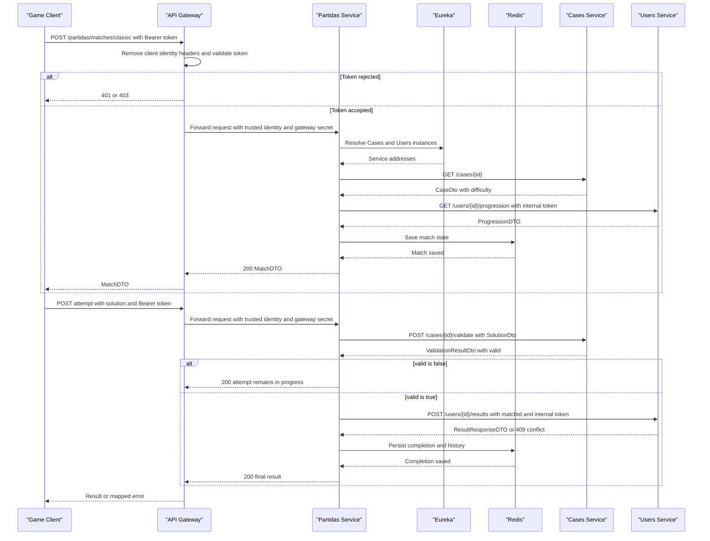

# API & Service Communication Contracts

Este documento inventaría las rutas HTTP y la comunicación entre servicios, y define los contratos acordados para esta fase. Keycloak/OIDC con MFA, el formato Problem Details compatible y tres intentos totales con backoff+jitter fueron confirmados por el usuario; los detalles marcados como propuesta siguen pendientes y no están implementados.

## Service Catalog

| Servicio | Puerto | Categoría | Propósito |
|---|---:|---|---|
| `api-gateway` | 8765 | API Layer | Enruta solicitudes externas a usuarios, casos y partidas. |
| `users_service` | 8081 | Business | Perfiles, progresión, estadísticas, logros y registro de resultados. |
| `cases-service` | 8082 | Business | Consulta, administración y validación de casos. |
| `partidas-service` | 8000 | Business | Partidas CLASSIC, TIMED y VERSUS, historial y ranking. |
| `eureka-server` | 8762 | Infrastructure | Registro y descubrimiento de servicios. El endpoint de gestión usa 8763. |
| PostgreSQL | 5432 en Compose local | Infrastructure | Persistencia de usuarios. |
| MongoDB | interno en Compose | Infrastructure | Persistencia de casos. |
| Redis | 6379 en Compose local | Infrastructure | Estado de partidas, ranking e historial de partidas. |
| Kafka | no definido por el Compose de producción local | Infrastructure | Broker usado por el flujo de demostración `poc.ping`. |

No hay un Compose raíz que levante y configure el conjunto completo; los Compose disponibles son por servicio o de integración aislada.

## API Endpoints Inventory

Las rutas de Gateway incluyen el prefijo del servicio; `StripPrefix=1` lo elimina antes de reenviar. Los endpoints de negocio listados son los del servicio, sin ese prefijo externo.

| Servicio/controlador | Método | Ruta del servicio | Request | Response / comportamiento |
|---|---|---|---|---|
| Gateway → usuarios | GET, PUT, PATCH | `/usuarios/users/me/**` | Según endpoint de usuario | Reenvía al servicio de usuarios con identidad confiable. |
| Gateway → usuarios público | GET | `/usuarios/health`, `/usuarios/swagger-ui/**`, `/usuarios/v3/api-docs/**` | — | Health y documentación; el Gateway añade el secreto de servicio al reenviar. |
| Keycloak | OIDC | Fuera de las rutas del Gateway | Authorization Code / token Bearer | El inicio de sesión y MFA ocurren en Keycloak; el Gateway valida access tokens. |
| Gateway → casos | ALL | `/casos/**` | Según endpoint de casos | Proxy hacia `cases-service`. |
| Gateway → partidas | ALL | `/partidas/**` | Según endpoint de partidas | Proxy hacia `partidas-service`. |
| UsersController | GET, PUT | `/users/me` | `UpdateProfileDTO` en PUT | `UserDTO`; GET crea el perfil si aún no existe. |
| UsersController | PATCH | `/users/me/language` | `LanguageDTO` | `UserDTO`. |
| UsersController | PUT | `/users/me/tutorial` | `TutorialDTO` | `UserDTO`. |
| UsersController | GET | `/users/me/stats` | — | `StatsDTO`. |
| UsersController | GET | `/users/me/achievements` | — | `List<AchievementDTO>`. |
| UsersController | GET | `/users/{id}/progression` | `id` de ruta; acceso interno | `ProgressionDTO`. |
| UsersController | POST | `/users/{id}/results` | `ResultDTO`; acceso interno | `ResultResponseDTO`; repetición idéntica por `matchId` es idempotente y payload contradictorio produce 409. |
| CasesController | GET | `/cases` | `ListCasesQueryDto` | `CaseSummaryDto[]`. |
| CasesController | GET | `/cases/{id}` | `id` de ruta | `CaseDto`, sin solución. |
| CasesController | GET | `/cases/{id}/hints` | `HintQueryDto` | `HintDto`. |
| CasesController | POST | `/cases/{id}/validate` | `SolutionDto` | `ValidationResultDto`; 200 con `valid: false` para solución incorrecta. |
| AdminCasesController | POST, PUT, DELETE | `/admin/cases[/{id}]` | `CreateCaseDto` | `CaseDto` en alta/actualización; requiere rol ADMIN. |
| AppController | GET | `/` | — | Texto de salud básico de Nest. |
| HealthController | GET | `/health` | — | Estado del servicio. |
| MetricsController | GET | `/metrics` | Credencial de métricas | Métricas HTTP en formato Prometheus. |
| Matches router | POST | `/matches/classic` | `ClassicMatchRequest` | `MatchDTO`. |
| Matches router | POST | `/matches/classic/{match_id}/attempts` | `ClassicAttemptRequest` | `ClassicAttemptResultDTO`; intento incorrecto deja la partida en curso. |
| Matches router | POST | `/matches/timed` | `TimedMatchRequest` | `MatchDTO`. |
| Matches router | POST | `/matches/timed/{match_id}/finish` | `SolutionDTO` | `ResultDTO`. |
| Matches router | POST, GET | `/matches/versus`, `/matches/versus/open` | `VersusMatchRequest` o — | `MatchDTO` / lista de partidas. |
| Matches router | POST | `/matches/versus/{match_id}/join` | `match_id` de ruta | `MatchDTO`. |
| Matches router | PUT, GET | `/matches/versus/{match_id}/progress` | `ProgressRequest` en PUT | Progreso propio o de participantes. |
| Matches router | POST | `/matches/versus/{match_id}/submit` | `SolutionDTO` | `VersusResultDTO`. |
| Matches router | GET | `/matches/ranking` | `limit` de query | `RankingEntryDTO[]`. |
| Matches router | GET | `/matches/history/me` | Identidad del usuario | `MatchResultDTO[]`. |
| Partidas | GET | `/health`, `/metrics` | Credencial de métricas en `/metrics` | Estado y métricas. FastAPI también publica `/docs`, `/redoc` y `/openapi.json`. |
| Eureka | GET | `/eureka/**` | Protocolo Eureka | Registro/descubrimiento; Actuator expone health y Prometheus en el puerto de gestión. |

Los endpoints HTTP no declaran una versión (`/v1`) ni un encabezado de versión.

## Management & Observability Endpoints

| Servicio | Endpoint | Observación |
|---|---|---|
| Gateway | Actuator según dependencias | Actuator está declarado; no se identificó una configuración de exposición de endpoints en el Gateway. |
| Users | `/health`, `/prometheus` | `/prometheus` protegido con Basic Auth local de métricas. |
| Cases | `/health`, `/metrics` | Métricas propias protegidas por `MetricsAuthGuard`; documentación en `/docs`. |
| Partidas | `/health`, `/metrics` | `/metrics` requiere credenciales; FastAPI ofrece documentación OpenAPI. |
| Eureka | `/actuator/health`, `/actuator/prometheus` en puerto 8763 | Scraping configurado en la aplicación. |

## DTOs & Contracts

- **Usuarios:** `UserDTO`, `UpdateProfileDTO`, `LanguageDTO`, `TutorialDTO`, `StatsDTO`, `AchievementDTO`, `ProgressionDTO`, `ResultDTO` y `ResultResponseDTO` son los contratos de perfil, preferencias, lectura e inscripción de resultados. El perfil se crea al primer GET de `/users/me`.
- **Casos:** `ListCasesQueryDto`, `HintQueryDto`, `SolutionDto` y `CreateCaseDto` representan filtros, pistas, soluciones enviadas y administración. `CaseSummaryDto`, `CaseDto`, `HintDto` y `ValidationResultDto` son respuestas. `CaseDto` excluye la solución persistida.
- **Partidas:** los modelos Pydantic de `app.schemas.matches` definen requests y responses de partidas, intentos, progreso, ranking e historial. Los modelos usan alias de contrato para conservar camelCase en JSON.
- No se identificó un DTO de agregación en el Gateway. Cada servicio es propietario de sus DTOs; no son entidades compartidas entre servicios.
- No hay un esquema común de errores, formato de versión o especificación OpenAPI centralizada. Users publica OpenAPI, Cases y Partidas generan documentos OpenAPI desde sus frameworks.

### Contratos acordados y decisiones pendientes

**Identidad y encabezados**

1. **Acordado:** usar Keycloak/OIDC y exigir MFA mediante la política del proveedor. El contrato de usuarios ya describe su `externalId` como subject de Keycloak; el JWT HMAC actual no implementa OIDC ni MFA.
2. El Gateway valida token, emisor, audiencia, vigencia y firma; traduce `sub` a `X-User-Id` y roles autorizados a `X-Roles`. El mapa exacto de claims OIDC debe confirmarse antes de implementar.
3. El Gateway elimina siempre cualquier `X-User-Id`, `X-Roles` o `X-Gateway-Secret` entrante del cliente y establece los valores de confianza. `X-Gateway-Secret` autentica el salto Gateway→servicio; `X-Internal-Token` queda reservado para las llamadas internas de partidas a usuarios. No enviar secretos al cliente.
4. No mantener un secreto JWT fijo como fallback de producción. Configuración de secretos vacía o ausente debe impedir el arranque en entornos no locales.

**Matriz de roles funcionales acordada**

| Actor | Permisos |
|---|---|
| Anónimo | Salud y documentación pública seleccionada; nunca rutas de negocio. |
| USER | Perfil propio, casos de lectura/pistas/validación y operaciones de juego del usuario autenticado. |
| ADMIN | Lo permitido a USER y CRUD de casos. |

`SERVICE` y `METRICS` quedan fuera de la matriz funcional de usuarios; sus credenciales técnicas no son roles de usuario ni parte de este alcance. `X-Internal-Token` seguirá protegiendo resultados/progresión internos y las métricas conservarán su credencial de scraping. El Gateway protege el endpoint de resultados al cliente y Cases exige ADMIN en CRUD. La comprobación de rol USER para rutas de casos/partidas no es uniforme hoy; debe agregarse y probarse.

**Validación de caso**

`POST /cases/{id}/validate` recibe `SolutionDto`; la respuesta exitosa tiene `{ "valid": true|false }` y puede incluir `killerFound` cuando aplica. No exponer ni depender de `isCorrect`. Código inválido o petición malformada responde 400; caso inexistente 404; servicio de casos no disponible responde 503 al cliente de partidas. Partidas debe tratar `valid` ausente o de tipo inesperado como error de integración, no como solución incorrecta.

**Formato de errores acordado**

Adoptar gradualmente un envelope compatible con Problem Details: `type`, `title`, `status`, `detail`, `instance`, `code`, `traceId` y, cuando aplique, `errors`. Mantener durante la migración los campos antiguos (`error`, `message`, `detail`, `detalles`) para evitar romper clientes; hacer que los consumidores usen primero `code` y `status`. No incluir secretos, payloads sensibles ni detalles internos de excepciones.

**Idempotencia, reintentos y DLQ**

- Para escritura de resultados, la clave funcional es `matchId` por usuario. El mismo `matchId` y contenido devuelve el resultado persistido; contenido diferente devuelve 409. No generar un ID nuevo al reintentar.
- Para eventos Kafka, `eventId` debe tener deduplicación persistente; la deduplicación actual de `poc.ping` está en memoria y se pierde al reiniciar.
- **Acordado:** reintentar solo fallos transitorios de red y respuestas 429/502/503/504; máximo tres intentos totales con backoff exponencial y jitter, respetando `Retry-After`. No reintentar errores 4xx no transitorios. Un POST solo se reintenta si su clave idempotente es estable y aceptada por el destino.
- Los mensajes inválidos van a DLQ con causa, topic/partición/offset y `eventId`. Fallos transitorios de procesamiento se reintentan de forma acotada; tras agotar intentos se envían a DLQ y se confirma el offset solo después de persistir el resultado o la entrada DLQ.
- Una partida no debe quedar cerrada sin mecanismo de recuperación si falla la escritura del resultado. Para esa ventana se requiere estado durable/outbox o una operación de reconciliación; el comportamiento actual de TIMED no repara el resultado con una repetición.

Los límites anteriores son contratos acordados, pero todavía no son políticas activas. La duración concreta del backoff y los SLO deben definirse antes de codificarlos. La deduplicación durable de eventos y el mecanismo de reconciliación/outbox siguen siendo propuestas pendientes.

## Communication Patterns

- **Síncrono:** Gateway enruta por Eureka a los tres servicios. Partidas llama a Cases para recuperar detalle/dificultad y validar soluciones; llama a Users para progresión y registrar resultados. Los clientes HTTP de partidas resuelven instancias mediante Eureka.
- **Asíncrono:** Kafka aparece en servicios como flujo de demostración `poc.ping`, no como transporte de eventos de negocio. El consumidor tiene reconexión exponencial de 1 a 30 segundos y envía mensajes inválidos directamente a DLQ; la deduplicación del ejemplo no es durable.
- **Timeout/resiliencia actual:** los clientes HTTP de partidas usan timeout configurable con default de 5 segundos; la consulta Eureka también usa 5 segundos. No se encontró circuit breaker ni reintento general para llamadas HTTP de negocio. La indisponibilidad de servicios se mapea a errores 502/503.
- **Descubrimiento y balanceo:** Eureka registra usuarios, casos, partidas y Gateway. Gateway usa `lb://` para upstreams; los clientes de partidas consultan el registro para seleccionar instancia.
- **Composición:** Gateway no combina respuestas. Partidas compone llamadas a Cases y Users para iniciar/finalizar partidas.
- **TLS:** hay soporte de instancia HTTPS en la configuración de registro para algunos escenarios; no se pudo confirmar TLS entre servicios para todos los despliegues.
- **Seguridad actual:** Gateway valida tokens OIDC de Keycloak mediante JWKS, issuer, expiración y audiencia configurados; mapea `sub` y `realm_access.roles` (`USER`/`ADMIN`) a encabezados confiables y no reenvía el Bearer token. MFA se exige en el flujo de Keycloak, no en el Gateway. El Gateway elimina encabezados de identidad/secretos enviados por el cliente, bloquea `/usuarios/users/{id}/results` y exige ADMIN para `/casos/admin/cases/**`. También inyecta `X-Gateway-Secret`; su valor debe coincidir con `GATEWAY_SECRET` en cada backend. Cases aún falla abierto si se despliega sin `GATEWAY_SECRET`, por lo que su configuración de entorno debe ser obligatoria.

## Service Technology Matrix

| Servicio | Web | Acceso a datos | Discovery | Gateway | Health | Cache/estado | Métricas |
|---|---|---|---|---|---|---|---|
| `api-gateway` | Spring WebFlux | — | Eureka client | Sí | Actuator declarado | — | Actuator declarado |
| `users_service` | Spring MVC | Spring Data JPA | Eureka client | No | Actuator | — | Prometheus |
| `cases-service` | NestJS / Express | Mongoose | Eureka client | No | `/health` | — | Prometheus |
| `partidas-service` | FastAPI | Redis repository/adapters | Eureka client | No | `/health` | Redis | Prometheus |
| `eureka-server` | Spring MVC | Registro Eureka | Discovery server | No | Actuator | Registro local | Prometheus |

## Service Communication Sequence

<!-- mermaid-checked: every participant uses `participant Id as "Label"`, no \n in aliases/messages/notes, every alt/opt/loop closed by end, no `:` inside any alias -->

